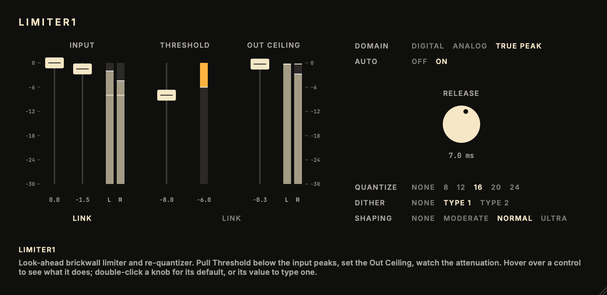

# Limiter1

A look-ahead brickwall peak limiter with an output re-quantizer (dither and noise shaping).<br>
Part of the codycodie plug-in collection.

Limiter1 raises the level, holds the peaks at a ceiling with no overshoot, and optionally dithers
and noise-shapes the result to the delivery word length. The look-ahead limiter follows the
published design of Giannoulis, Massberg and Reiss (2012). The re-quantizer uses error-feedback
noise shaping after Gerzon and Craven (1989) and Lipshitz, Vanderkooy and Wannamaker (1991). The
look-ahead length, release curve, Auto law, true-peak detector, Analog margin, dither levels and
shaper coefficients are designed and measured for this plug-in, not taken from any other product.
[docs/dsp.md](docs/dsp.md) lists every constant and measurement.



The editor is built for the mastering workflow: look at the input peaks, pull Threshold below
them, set the Out Ceiling and watch the attenuation. Faders and meters share one dB scale. The
line across the input meters is the Threshold and the line across the output meters is the
Ceiling. Hovering over a control explains it in the strip at the bottom. The window scales from
half to double size by dragging its corner.

Limiter1 is an independent product identity. Its bundle identifier is `com.c0dypeng.limiter1`, its
manufacturer code is `Cdpg` and its plug-in code is `Lim1`. It builds as AU and VST3. This
repository is licensed under GPL-3.0 (see [LICENSE](LICENSE)).

## Downloads

Get the latest packages from the [Limiter1 releases page](https://github.com/chijenpeng/limiter1/releases/latest). The macOS release contains Universal AU and VST3 bundles for Apple Silicon and Intel; the bundles are ad-hoc signed and not notarized. The Windows release contains a native x64 VST3, unsigned. Each ZIP includes `INSTALL.txt`, `THIRD_PARTY_NOTICES.md`, `LICENSE`, the dependency licences and build provenance, with a `.sha256` companion file.

## Controls

| Control | Range | What it does |
|---|---|---|
| Input L / Input R | −30..0 dB | Input level per channel, before the limiter. Link Inputs moves them together (a UI convenience; the two values are what is stored). |
| Threshold | −30..0 dB | Peaks above this are limited. Everything below gets a constant gain of Ceiling − Threshold, so lowering the threshold raises the level. |
| Out Ceiling | −30..0 dB | The highest level that leaves the plug-in. −0.3 to −0.5 dB is the usual choice for delivery. |
| Link | on/off | Moves Threshold and Ceiling together by the same number of dB. Turning it on never changes the sound. |
| Release | 0.01..1000 ms | How fast the gain recovers after a peak: the time constant of the recovery, so about 95 % of it is done in three times the marked value. Short (1–7 ms) for most work; 20–40 ms for heavy limiting. Default 100 ms. |
| Auto Release | on/off | Program-dependent release: isolated peaks recover at the Release setting; sustained limiting lengthens the release progressively (up to 500 ms), which keeps low notes clean under heavy limiting. |
| Domain | Digital / Analog / True Peak | What "the ceiling" means. Digital: no sample above it. True Peak: the reconstructed waveform between samples stays below it too. Analog: True Peak with an extra 1.5 dB of margin, chosen for this plug-in. |
| Quantize | None / 8 / 12 / 16 / 20 / 24 bit | Output word length. None leaves the floating-point output untouched. |
| Dither | None / Type 1 / Type 2 | Type 1: TPDF, removes distortion at low level, the standard choice. Type 2: RPDF, 1.8 dB quieter, a little low-level distortion remains, and it is silent on digital silence. |
| Shaping | None / Moderate / Normal / Ultra | Pushes the dither and rounding noise up above 15 kHz where the ear is least sensitive: about 6 / 8.5 / 10.5 dB less audible noise at 44.1/48 kHz (Terhardt-weighted). Works without dither too. Ultra is for the final pass only; Normal if the file will be edited again. |

Limits: the True Peak ceiling holds for content below 0.45 × the sample rate; full-band content
such as Nyquist bursts can reconstruct up to 1.15 dB over it, depending on the converter. The
Analog margin of 1.5 dB is chosen for this plug-in and bounded by the probes in
[docs/dsp.md](docs/dsp.md). Latency is fixed for every setting and reported to the host: 82
samples at 44.1 kHz, 88 at 48 kHz, 160 at 96 kHz and 304 at 192 kHz (1.5 ms of look-ahead plus
the detector).

## Build

The project requires CMake 3.22 or later and a C++17 compiler. For AU and VST3 builds, use macOS
11 or later; the Windows VST3 release uses native x64 MSVC from Visual Studio 2022. It uses JUCE
8.0.9. Put a local checkout at `third_party/JUCE` to avoid a fetch; otherwise CMake downloads
that tagged release while configuring.

```sh
cmake -S . -B build -G Ninja -DCMAKE_BUILD_TYPE=Release
cmake --build build -j3
ctest --test-dir build --output-on-failure
```

On Windows, configure with `cmake -S . -B build -G "Visual Studio 17 2022" -A x64
-DCOPY_PLUGIN_AFTER_BUILD=OFF`, build with `cmake --build build --config Release --parallel 2`
and test with `ctest --test-dir build -C Release --output-on-failure`.

Plug-in copying is disabled by default, so builds stay in the build tree. To copy the AU and
VST3 bundles into the current user's Audio Plug-Ins folders, configure with
`-DCOPY_PLUGIN_AFTER_BUILD=ON`. Build products are under `build/Limiter1_artefacts/Release`.

## Validation and snapshots

`limiter1_test` (CTest `limiter_test`) checks latency, threshold and ceiling gain, release,
Auto Release, fader clicks, the quantizer, noise shaping, determinism and the ceiling in every
domain (zero overshoot on squares, impulses, bursts, tones and noise at every supported rate).
It prints PASS or FAIL per check and exits non-zero on any failure.

```sh
./build/limiter1_test            # all checks
./build/limiter1_test ceiling    # one group: latency, threshold, release, auto, clicks, quantizer, shaping, determinism, ceiling
cmake --build build --target limiter1_snapshot
./build/limiter1_snapshot_artefacts/Release/limiter1_snapshot docs/editor.png
```

`limiter1_render` is an offline utility that runs a WAV file through the exact plug-in
processor. Its output is time-aligned with the input (`--keep-latency` keeps the look-ahead
delay), and the quantized words are written exactly, as 32-bit float by default or as 16/24-bit
integers with `--out-bits`:

```sh
./build/limiter1_render_artefacts/Release/limiter1_render in.wav out.wav \
    --threshold -6 --ceiling -0.3 --release 7 --auto 1 --domain tp --quantize 16 --dither 1 --shaping normal
```

After a Release build with `-DCMAKE_OSX_ARCHITECTURES="arm64;x86_64"` in `build-release`, macOS
packaging is `tools/package_macos.sh`. It requires a clean Git tree and writes the ZIP and its
SHA-256 file under `build-release/dist/`.
